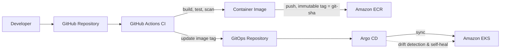

# Deployment Architecture

## 1. Environments

| Environment | Purpose | EKS Namespace | Approval Gate |
|---|---|---|---|
| `dev` | Continuous integration target, feature validation | `staging` (shared cluster, namespaced) or dedicated dev cluster | None — auto-sync |
| `staging` | Pre-production validation, E2E/Selenium, performance | `staging` | Auto-sync, manual promotion to production |
| `production` | Live traffic | `production` | Manual Argo CD sync approval |

## 2. Deployment Flow (GitOps)



CI produces artifacts and updates the desired-state manifest (image tag) in the GitOps
repository. **Argo CD — not GitHub Actions — is the only system that talks to the
Kubernetes API for application workloads.**

## 3. Deployment Strategy

- **Initial:** Rolling deployment via standard Kubernetes `Deployment` rollout, gated by
  readiness probes and a `PodDisruptionBudget`.
- **Extensible to:** Canary (via Argo Rollouts or a service-mesh traffic split) and
  Blue/Green, without changing the GitOps delivery model — only the Argo CD Application
  strategy changes.
- **Kafka consumer scaling:** KEDA `ScaledObject` driven by consumer group lag, in addition
  to/instead of CPU-based HPA where consumer throughput is the true bottleneck.

## 4. Promotion Model

```text
feature/* → develop → (CI + auto-deploy to dev)
develop → release/* → staging (CI + auto-deploy, Selenium E2E + performance gates)
release/* → main → production (manual Argo CD sync approval)
hotfix/* → main + develop (expedited path, same gates, abbreviated soak)
```

## 5. Rollback

- Argo CD retains full deployment history per Application; rollback is a `history` revert,
  not a rebuild.
- Helm chart versioning (`Chart.yaml` `version`) plus image tag pinning (`service:<git-sha>`)
  make every previous state exactly reproducible.
- See `docs/runbooks/rollback.md`.
