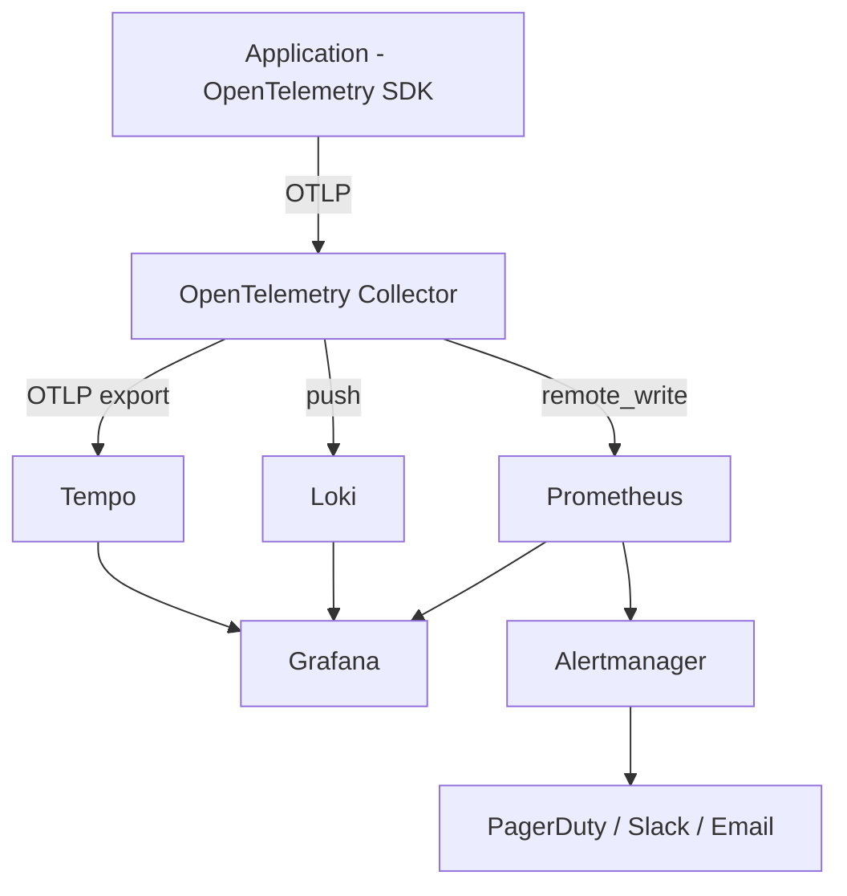

# Observability Architecture

## 1. Three Pillars



- **Metrics → Prometheus → Grafana**
- **Logs → Loki → Grafana** (structured JSON, correlated by `traceId`)
- **Traces → Tempo → Grafana** (full request path, including Kafka hops)
- All three share `traceId`/`spanId`/`correlationId` as the correlation key, enabling
  "click from a Grafana metric spike into the exact trace and logs."

## 2. Instrumentation Standard

Every service (once implemented) is instrumented via the OpenTelemetry Java/Java agent
or SDK, auto-configured through `libs/common-observability`, exporting via OTLP to the
per-cluster OpenTelemetry Collector (`infrastructure/monitoring/otel-collector-config.yaml`).

Trace propagation path:

```text
Frontend → API Gateway → Domain Service → MongoDB (span) → Kafka (producer span)
                                                                 │
                                                     Kafka (consumer span) → Domain Service → MongoDB (span)
```

W3C Trace Context headers (`traceparent`, `tracestate`) are propagated across HTTP hops;
Kafka producer instrumentation injects trace context into message headers so consumer
spans link back to the originating trace.

## 3. Metrics Catalogue

See `infrastructure/monitoring/prometheus-rules.yaml` and
`docs/observability/metrics-catalogue.md` for the full, queryable list. Summary:

- **Application:** HTTP request count/error count/latency (P50/P95/P99), JVM memory, JVM
  CPU, GC pauses, thread pool saturation.
- **MongoDB:** connection pool usage, query latency, error rate, timeouts (via the MongoDB
  driver's built-in metrics + Atlas monitoring integration).
- **Kafka:** consumer lag (per group/partition), producer error rate, consumer error rate,
  records/sec, partition leader health, rebalance frequency, DLT topic volume.
- **Kubernetes:** CPU/memory (requests vs. actual), pod count, restart count, node health,
  network I/O, container OOM/failure events (via kube-state-metrics + node-exporter).
- **Business:** indents submitted/approved/rejected, pending approvals, POs
  created/issued, goods received/rejected, stock movements, low-stock item count, outward
  requests, returns, assets created/closed, SLA breaches.

## 4. Dashboards

Grafana dashboards (provisioned as code, `infrastructure/monitoring/grafana/dashboards/`)
per layer:

1. Platform overview (golden signals across all services)
2. Per-service detail (one dashboard template, parameterized by `service` variable)
3. Kafka health (lag, DLT volume, rebalances)
4. MongoDB health
5. Kubernetes cluster health
6. Business KPIs (procurement funnel, SLA compliance)

## 5. Alerting

Alertmanager routes, defined in `infrastructure/monitoring/alertmanager-config.yaml`,
grouped by severity:

- **Page (critical):** error rate SLO breach, Kafka consumer lag beyond threshold sustained
  >5m, pod crash-looping, DLT volume spike, MongoDB connection saturation.
- **Notify (warning):** elevated latency (P95 above target), approaching HPA max
  replicas, certificate expiry <14 days, low-stock alerts (business-relevant, routed to a
  business Slack channel rather than SRE on-call).

## 6. Log Standard

Structured JSON logs only (see `docs/observability/logging-standard.md`), correlated via
`traceId`/`spanId`/`correlationId`/`eventId`/`userId`/`requestId`. Sensitive fields
(passwords, tokens, secrets, full documents) are never logged — enforced via a shared
logging filter in `libs/common-observability`.
