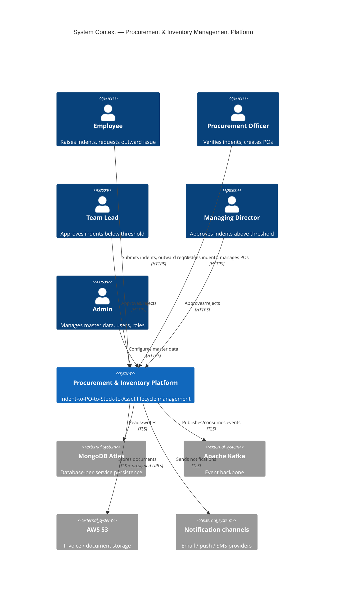
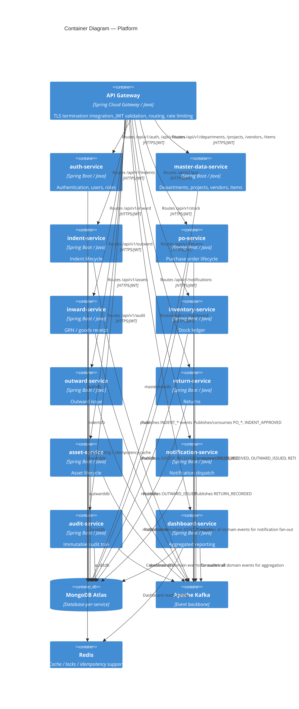

# System Architecture

## 1. Overview

The platform is a domain-driven, event-backed microservices system for Procurement &
Inventory Management. It is composed of 12 independently deployable business services
sitting behind a single API Gateway, communicating synchronously via REST for
request/response flows and asynchronously via Apache Kafka for cross-domain state
propagation.

## 2. C4 — System Context

## 3. C4 — Container Diagram

## 4. Design Principles

1. **Database-per-service** — no cross-service MongoDB access, ever.
2. **Kafka-first async** — Kafka is the only cross-domain asynchronous mechanism; it is
   never used as a synchronous RPC substitute.
3. **Gateway is infrastructure, not business logic** — authentication and coarse-grained
   routing only; authorization decisions are re-validated inside each domain service.
4. **Outbox + idempotent consumers** — no event is lost on Kafka publish failure, and no
   event is double-applied on redelivery.
5. **Everything observable** — every request carries `traceId` / `spanId` / `correlationId`
   from the gateway through to Kafka consumers.
6. **Externalized configuration** — no hardcoded secrets, credentials, or environment-specific
   URLs anywhere in source control.
7. **GitOps delivery** — Argo CD is the only actor that changes cluster state; CI never runs
   `kubectl apply` against production.

## 5. Service Responsibility Matrix

| Service | Publishes | Consumes |
|---|---|---|
| indent-service | `INDENT_SUBMITTED`, `INDENT_VERIFIED`, `INDENT_APPROVED`, `INDENT_REJECTED` | — |
| po-service | `PO_CREATED`, `PO_ISSUED`, `PO_CLOSED` | `INDENT_APPROVED` |
| inward-service | `GOODS_RECEIVED`, `REJECTION_FLAGGED` | `PO_ISSUED` |
| inventory-service | `LOW_STOCK_ALERT` | `GOODS_RECEIVED`, `OUTWARD_ISSUED`, `RETURN_RECORDED` |
| outward-service | `OUTWARD_ISSUED` | — (validates against inventory-service synchronously) |
| return-service | `RETURN_RECORDED`, `ASSET_CLOSURE_REQUESTED` | — |
| asset-service | `ASSET_CREATION_REQUESTED` (consumed), `ASSET_STATUS_CHANGED` | `OUTWARD_ISSUED`, `ASSET_CLOSURE_REQUESTED` |
| notification-service | — | all domain events |
| audit-service | — | all domain events |
| dashboard-service | — | all domain events |

See `architecture/event-driven-architecture.md` for the full event catalogue and envelope.
